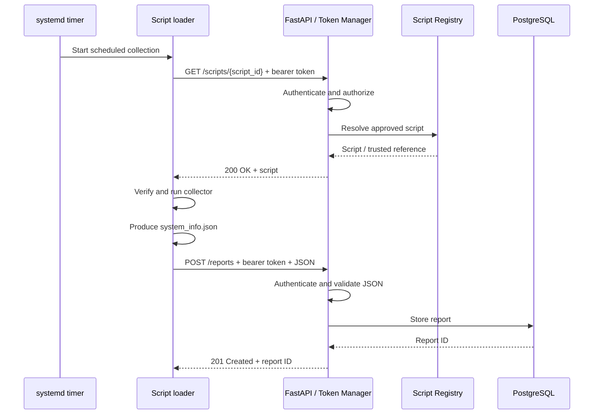

# RootMap — Scheduled Collection Design (Pre-MVP)

## Goal
Demonstrate one complete scheduled collection cycle: a client retrieves an authorized collection script from the backend, runs it, and submits a JSON report for storage.

## Components
- **systemd timer:** Starts the client-side script loader on a schedule.
- **Script loader (client):** Requests a script, runs the approved collector, and uploads its report.
- **Token Manager (FastAPI):** Authenticates requests and checks client permissions. This can be shared authentication logic rather than a separate network service.
- **Script Registry:** Maps an authorized client/script identifier to a known collection script.
- **Report ingestion API:** Validates incoming JSON and saves the report.
- **PostgreSQL:** Persists hosts and collection reports (can be deferred during initial endpoint testing).

## Scheduled collection sequence
1. A **systemd timer** triggers the client script loader.
2. The loader sends `GET /scripts/{script_id}` with `Authorization: Bearer <token>` over HTTPS.
3. FastAPI validates the token and confirms the client may request that script. Invalid credentials return `401`; insufficient permissions return `403`.
4. The backend looks up the approved script in the **Script Registry**.
5. FastAPI returns the script (or a trusted script reference) in the original GET response.
6. The loader verifies the script's integrity and executes it with limited privileges.
7. The collector generates `result/system_info.json`.
8. The loader sends `POST /reports` with the JSON body and its bearer token.
9. FastAPI authenticates the request, validates the report, and stores it in PostgreSQL.
10. The backend returns a success response with a report ID; the client records success or failure.



## Initial collector payload
Keep compatibility with the existing `host_scripts/system_collector.py` output:

```json
{
  "Operating System": "Ubuntu",
  "OS Release": "22.04.3 LTS (Jammy Jellyfish)",
  "Hostname": "hatchery",
  "IP Address": "192.168.220.76",
  "Subnet Mask": "24"
}
```

Use Pydantic field aliases to accept these keys without changing the collector. Note that `"24"` is a CIDR prefix length, not a dotted-decimal subnet mask.

## API contract (proposed)
| Endpoint | Auth | Result |
| --- | --- | --- |
| `GET /scripts/{script_id}` | Bearer token + script authorization | `200` script, `401` invalid token, `403` forbidden, `404` unknown script |
| `POST /reports` | Bearer token | `201` with report ID, `401` invalid token, `422` invalid JSON |
| `GET /reports/{report_id}` | Bearer token + read permission | `200` stored report, `404` not found |

## Implementation order
- [ ] Define the Pydantic report model and request/response contracts.
- [ ] Implement token verification and client-to-script authorization.
- [ ] Add a minimal registry with one approved collector script.
- [ ] Implement authenticated script GET in FastAPI.
- [ ] Connect the client loader to GET, integrity-check, and execute the collector.
- [ ] Implement authenticated report POST and JSON validation.
- [ ] Persist reports in PostgreSQL; add retrieval endpoint.
- [ ] Add systemd service/timer and run an end-to-end demo.

## Pre-MVP boundaries
Focus on **scheduled collection** first. SSH-triggered manual collection, a full dashboard, dependency graph generation, and a large script catalog can follow later. Avoid executing arbitrary scripts from client input; only serve scripts explicitly registered and authorized by the backend. Never put tokens in URL query parameters or log them.

## Demo acceptance criteria
A timer (or manual invocation of its service) launches the loader; an authorized client fetches and runs `system_collector.py`; the backend receives and validates its JSON; the report survives a backend restart; and a GET request can retrieve it. Unauthorized script or report requests are rejected.
